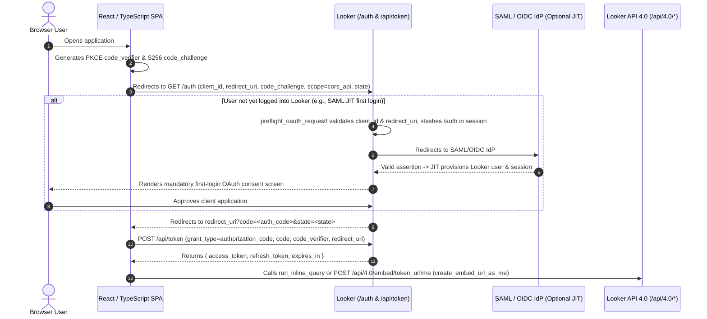

# Looker OAuth 2.0 PKCE Architecture & Sequence

This reference documents the end-to-end authentication lifecycle, strict `redirect_uri` validation rules, and SAML Just-in-Time (JIT) user provisioning mechanics for Looker's OAuth 2.0 PKCE (`cors_api`) flow.

---

## 1. End-to-End OAuth 2.0 PKCE + Embed URL Sequence



---

## 2. Registering the OAuth Client Application (`OauthClientApp`)

Register your SPA via the Looker API Explorer (`Admin > Platform > API Explorer` -> `Auth` -> `register_oauth_client_app`) or SDK:

```python
import looker_sdk
from looker_sdk import models40 as models

sdk = looker_sdk.init40()
sdk.register_oauth_client_app(
    client_guid="my-spa-client",
    body=models.WriteOauthClientApp(
        redirect_uri="https://app.example.com/callback",
        redirect_uris=[
            "https://app.example.com/callback",
            "https://staging.example.com/callback",
            "https://localhost:3000/callback",
        ],
        display_name="Analytics Portal SPA",
        description="Browser-based analytics application using OAuth 2.0 PKCE",
        enabled=True,
    ),
)
```

---

## 3. Strict `redirect_uri` Validation Rules (No Wildcards)

Looker validates `redirect_uri` during both the authorization request (`GET /auth`, `POST /auth`) and the token exchange (`POST /api/token`):

1. **Exact Character-for-Character Matching (`==`)**:
   - Looker **does not support wildcards (`*`), globs, or regular expressions** in `redirect_uri` or `redirect_uris` (whether in the path, query string, subdomain, or port).
   - Any difference between the request's `redirect_uri` and the registered URI—including a trailing slash (`/`), a dynamic subpath (`/callback/report-42`), or inline query parameters—causes Looker to reject the request with `400 Bad Request`.
2. **RFC 8252 Loopback IP Exception**:
   - Dynamic port matching is permitted **only** for IPv4/IPv6 loopback literals (`http://127.0.0.1:<port>/...` or `http://[::1]:<port>/...`) for native/CLI loopback flows. Notably, `https://localhost:<port>` does **not** qualify as an IP literal and requires exact port registration.
3. **Handling Dynamic Return Paths Without Wildcards**:
   - **Option A (`redirect_uris` Array)**: Register a finite list of static environment callbacks in `redirect_uris: string[]`.
   - **Option B (OAuth `state` or `sessionStorage`)**: Register a single static callback URI (`https://app.example.com/callback`). Before redirecting to `/auth`, store the user's intended deep-link destination (e.g., `/dashboards/42?region=APAC`) in `sessionStorage` or encode it in the OAuth `state` parameter, then route the user there via React Router after `/api/token` completes.

---

## 4. First-Login SAML / OIDC Just-in-Time (JIT) Provisioning Behavior

When a user who has never logged into Looker initiates a CORS OAuth PKCE flow while SAML or OIDC authentication is enabled:
1. Looker runs `preflight_oauth_request!` before enforcing session authentication, verifying `client_id` and `redirect_uri` and saving the full `/auth?...` request URL in the session return path.
2. Looker redirects the browser to the SAML/OIDC Identity Provider. Upon receiving a valid assertion on callback, Looker JIT-provisions the user record, assigns groups/roles, and redirects back to `/auth`.
3. Because a newly provisioned user has never authorized the `OauthClientApp`, Looker displays the **interactive OAuth consent screen** on first login. Therefore, the initial OAuth PKCE login must always run in a top-level browser window or popup—never inside a hidden `0x0` iframe.
